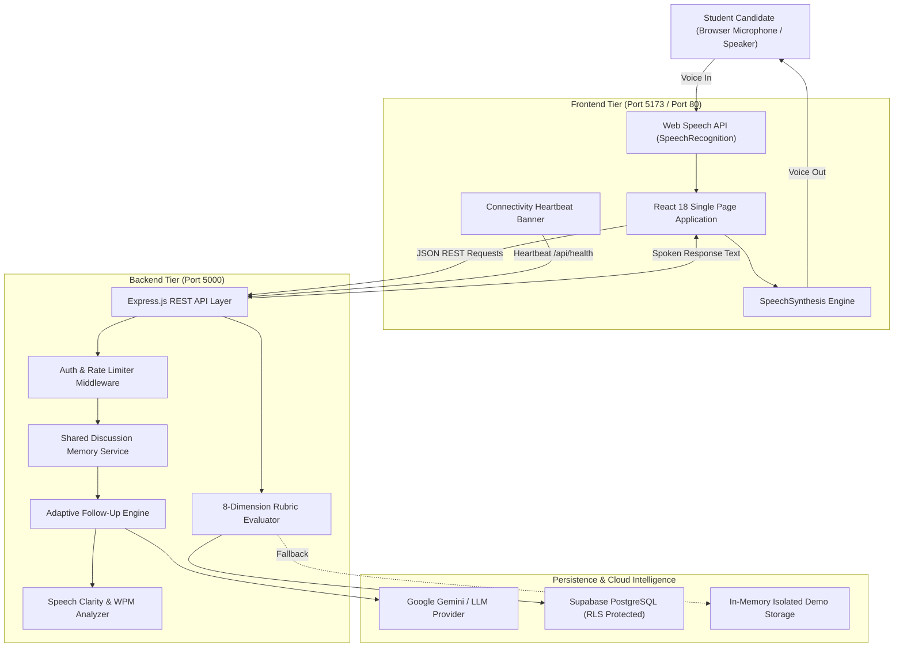
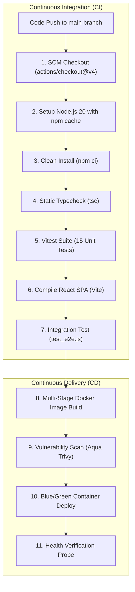
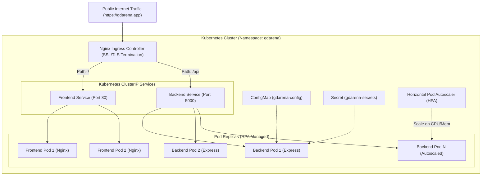
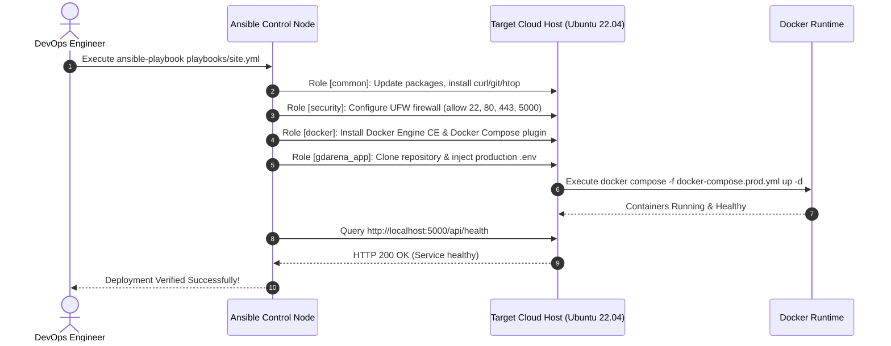

# GD ARENA — CLOUD & DEVOPS ARCHITECTURE DIAGRAMS

This document contains visual architectural specifications for **GD Arena**, illustrating multi-tier containerization, CI/CD automation, Kubernetes clustering, and Infrastructure as Code.

---

## 1. High-Level System & Voice AI Architecture



---

## 2. Multi-Container Docker Compose Architecture

```mermaid
graph LR
    subgraph DockerHost ["Docker Host (Bridge Network: gdarena-network)"]
        subgraph FrontendContainer ["Container: gdarena-frontend (Port 5173:80)"]
            Nginx["Nginx Alpine Web Server"]
            StaticAssets["Compiled React SPA (HTML/JS/CSS)"]
            Nginx --> StaticAssets
        end

        subgraph BackendContainer ["Container: gdarena-backend (Port 5000:5000)"]
            NodeJS["Node.js 20 Alpine Runtime"]
            ExpressApp["Express Application Service"]
            HealthCheck["Docker Healthcheck (curl /api/health)"]
            NodeJS --> ExpressApp
            NodeJS --> HealthCheck
        end
    end

    Browser["Client Web Browser"] -->|Port 5173 (HTTP)| Nginx
    Nginx -->|Reverse Proxy /api/| ExpressApp
    Browser -->|Direct API (Port 5000)| ExpressApp
```

---

## 3. Automated CI/CD Pipeline (GitHub Actions & Jenkins)



---

## 4. Kubernetes Cluster Pod Topology & Ingress Routing



---

## 5. Ansible Infrastructure as Code (IaC) Workflow


